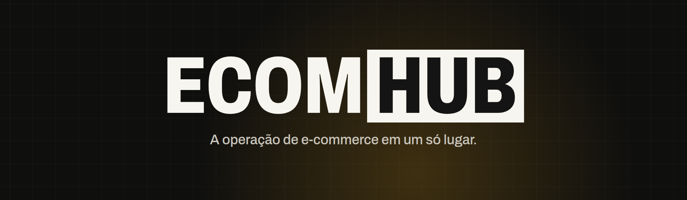
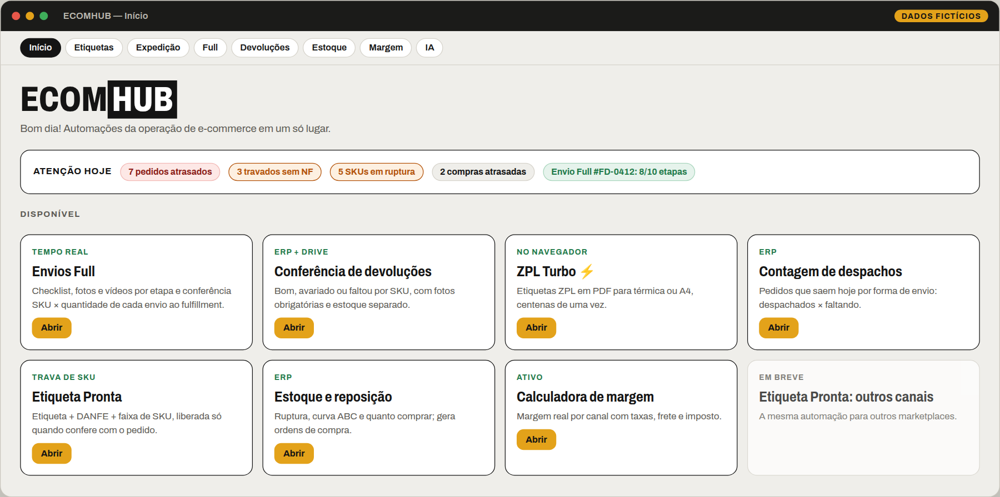
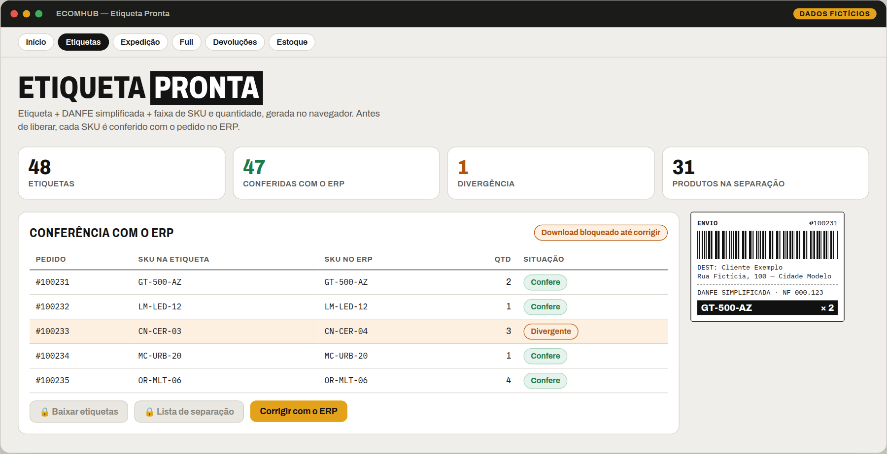
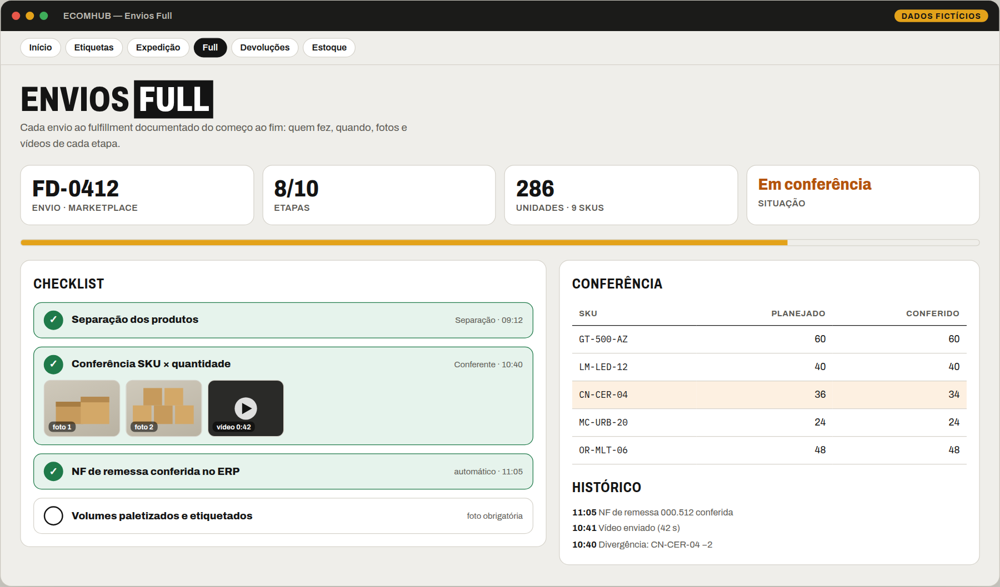
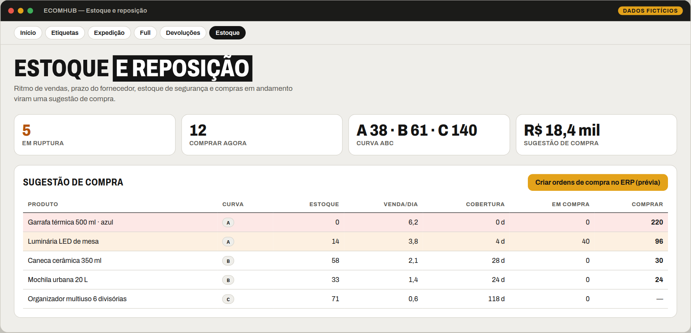
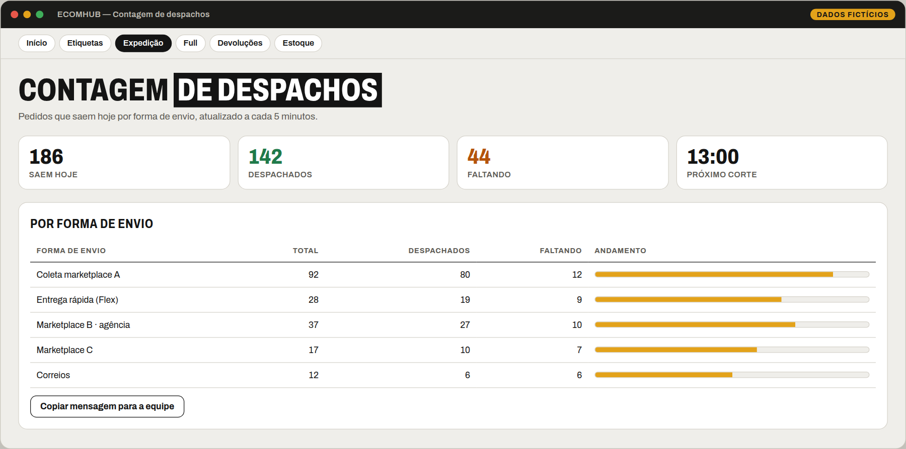
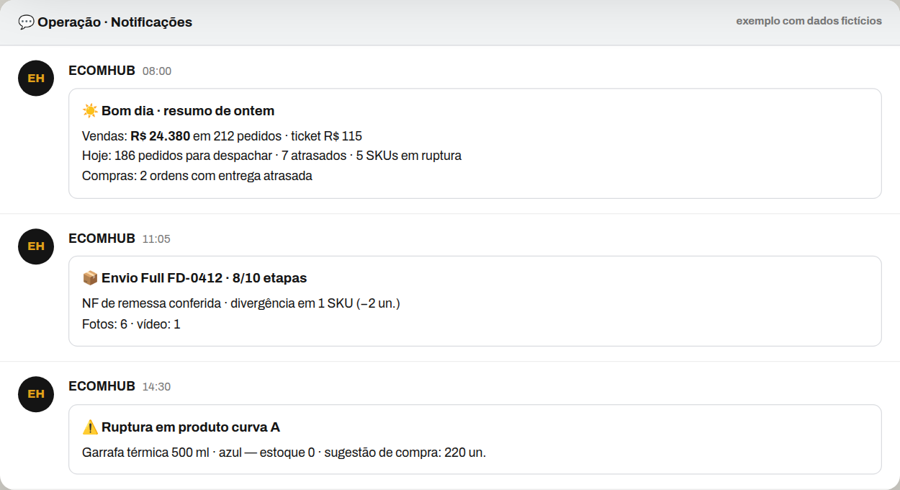
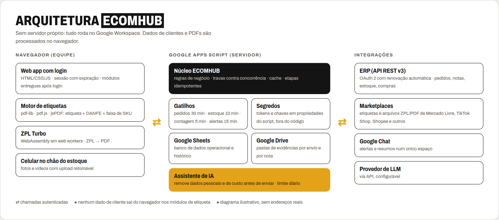

**Uma plataforma única que substitui várias ferramentas avulsas na operação diária de vendas online.**
Etiquetas, expedição, fulfillment, devoluções, margem, estoque, reposição, alertas e IA, num só lugar.

---

> **Repositório de apresentação.** O código-fonte é **privado** e não é distribuído aqui. Todas as imagens desta página são **demonstrações com dados fictícios**: produtos, pedidos, valores e nomes foram inventados.

## O que é

O **ECOMHUB** é uma central de operação para quem vende em vários marketplaces. Ele reúne num único painel com login as rotinas que normalmente ficam espalhadas entre planilhas, papel e assinaturas de ferramentas diferentes. Conecta-se ao ERP da operação e roda inteiramente no Google Workspace, sem servidor próprio.

Foi **idealizado e desenvolvido por Lucas T.I** a partir de gargalos observados no dia a dia de uma operação de e-commerce multicanal.

## O problema

Vender em vários marketplaces cria trabalho repetitivo e custo escondido:

- etiquetas montadas na mão, com risco de enviar o produto errado;
- conferência de expedição em papel;
- planilhas de margem desatualizadas;
- ruptura de estoque descoberta tarde demais;
- envios ao fulfillment e devoluções sem registro de quem fez o quê;
- uma assinatura diferente para cada tarefa.

## Como funciona

A tela inicial mostra os módulos liberados para cada usuário e uma barra **Atenção hoje** com o que pede ação: pedidos atrasados, travados, ruptura, compras atrasadas e o andamento do fulfillment.

## Módulos implementados

### Expedição

| Módulo | O que entrega |
|---|---|
| 🏷️ **Etiqueta Pronta · Mercado Livre** | Etiqueta + DANFE simplificada + faixa de SKU/quantidade em PDF, gerada no navegador, com lista de separação. **Trava de segurança:** cada SKU é conferido com o pedido no ERP e o download só libera se tudo bater |
| 🏷️ **Etiqueta Pronta · TikTok Shop** | Mesmo fluxo para o TikTok Shop, juntando etiqueta, lista de embalagem e NF-e |
| ⚡ **ZPL Turbo** | Converte etiquetas ZPL em PDF (térmica ou A4) direto no navegador, centenas de uma vez; remove repetidas e conta por transportadora |
| ✅ **Conferência de expedição** | Bipe por pacote: faltando, repetido, fora da coleta, com histórico |
| 🚚 **Contagem de despachos** | Pedidos que saem hoje por forma de envio, despachados × faltando, com mensagem pronta para a equipe |
| ⏱️ **Pedidos atrasados e travados** | O que está perto de estourar o prazo e o que parou no caminho (faturado sem envio, sem NF, parado em aberto), com regras editáveis |

### Fulfillment e devoluções

| Módulo | O que entrega |
|---|---|
| 📦 **Envios Full** | Checklist de cada envio ao fulfillment do Mercado Livre, com responsável e horário, fotos e vídeos por etapa (upload retomável pelo celular), conferência SKU × quantidade, NF de remessa conferida no ERP e andamento em tempo real |
| ↩️ **Conferência de devoluções** | Recebimento por SKU (bom, avariado, faltou), fotos obrigatórias organizadas por nota no Drive, marcação no ERP e separação entre estoque liberado e avariado, sem lançamento duplicado |
| 📉 **Devoluções** | Taxa de devolução por SKU e por canal |

### Gestão

| Módulo | O que entrega |
|---|---|
| 💰 **Calculadora de margem e margem por produto** | Margem real por canal, com taxas por faixa de preço, frete e imposto; preço mínimo |
| 📊 **Estoque e reposição** | Ruptura, curva ABC e **quanto comprar**; gera as ordens de compra no ERP com prévia |
| 🔥 **Queima de estoque** | Produto parado, dinheiro parado e menor preço de promoção que ainda respeita a margem mínima |
| 🧾 **Saúde do cadastro** | GTIN, peso e medidas, NCM, foto, descrição e custo: o que falta em cada produto |
| 📈 **Painel de vendas e relatório de meta** | Faturamento, pedidos, ticket e cancelamentos por canal; acompanhamento de meta (acesso restrito) |
| 🔔 **Notificações** | Alertas automáticos num único espaço do Google Chat |
| 🤖 **Assistente de IA (texto)** | Rascunhos de anúncios e respostas a compradores a partir do cadastro do produto |

<table><tr>
<td width="55%"></td>
<td width="45%"></td>
</tr></table>

### Em desenvolvimento

| Item | Situação |
|---|---|
| Etiqueta Pronta para outros marketplaces (Shopee, Amazon) | Planejado; aparece como "Em breve" no painel |
| Envios Full para a Shopee | Planejado; hoje o módulo atende o Mercado Livre |
| Lançamento automático de estoque nas devoluções | Implementado, mas **desligado por padrão** até cada operação confirmar como o ERP trata a nota de devolução |

## Arquitetura

- **Navegador:** telas em HTML/CSS/JS; o motor de etiquetas (pdf-lib, pdf.js, jsPDF) e o conversor ZPL (WebAssembly em *web workers*) processam os arquivos **localmente**.
- **Servidor:** Google Apps Script com regras de negócio, travas contra execução concorrente, cache e etapas idempotentes. Gatilhos periódicos sincronizam pedidos, estoque, contagem e alertas.
- **Dados:** Google Sheets como base operacional; Google Drive para fotos e vídeos de evidência.
- **Integrações:** API REST do ERP com OAuth 2 e renovação automática de token; Google Chat; provedor de LLM via API.

## Segurança e privacidade

| Camada | Como é tratada |
|---|---|
| Acesso | Login próprio, senhas com *hash* e *salt*, validade configurável por usuário |
| Sessão | Expira automaticamente; uma sessão ativa por usuário; bloqueio temporário após tentativas erradas |
| Segredos | Chaves e tokens ficam fora do código, em armazenamento protegido da plataforma |
| Módulos sensíveis | O servidor só entrega tela e dados a quem está na lista de acesso |
| Dados de clientes | PDFs e etiquetas são processados no navegador de quem usa |
| IA | Remove dados pessoais (CPF, CNPJ, e-mail, telefone, CEP) e de custo e fornecedor antes de qualquer envio; limite diário |

## Qualidade

Os cálculos críticos são cobertos por **15 suítes de testes automatizados com mais de 900 verificações**, executadas a cada mudança.

| Área | Cobertura |
|---|---|
| Estoque e reposição | 512 verificações contra um cálculo independente, com testes de mutação |
| Etiquetas, ZPL e conferência de SKU | 45 verificações, incluindo pacotes com vários produtos |
| Envios Full, devoluções e contagem | 124 verificações, incluindo repetição segura de etapas |
| Painel, operação, compras, margem e notificações | 193 verificações |
| Assistente de IA | 30 verificações, incluindo a remoção de dados pessoais |

## Benefícios e aplicação comercial

**Benefícios**
- Menos ferramentas pagas: as rotinas rodam na infraestrutura Google que a operação já usa.
- Menos erro de expedição: a etiqueta só sai quando os produtos conferem com o pedido.
- Rastreabilidade: fotos, vídeos, responsável e horário de cada envio e devolução, consultáveis depois.
- Decisão mais rápida: alertas no Chat e sugestão de compra calculada.

**Possibilidades de aplicação**
- Implantação para outras lojas que vendem em vários marketplaces e usam ERP com API.
- Oferta como serviço (configuração, adaptação de regras e suporte).
- Módulos isolados, como o ZPL Turbo ou a Etiqueta Pronta, como produtos independentes.

Essas aplicações dependem de adaptação a cada operação e da revisão das licenças de bibliotecas de terceiros.

## Tecnologias

Google Apps Script · JavaScript · HTML/CSS · Google Sheets · Google Drive · Google Chat · Google Sites · WebAssembly · pdf-lib · pdf.js · jsPDF · Python (Google Colab) · APIs REST com OAuth 2 · LLMs via API

## Autoria e propriedade intelectual

Projeto **idealizado e desenvolvido por Lucas T.I** ([@comercial-lucasti](https://github.com/comercial-lucasti)). Software proprietário: não há licença de uso, cópia, modificação ou distribuição sem autorização escrita do autor (veja [LICENSE](LICENSE)).

## Contato

Quer ver uma demonstração ou conversar sobre uma solução parecida para a sua operação? Fale comigo pelo [perfil](https://github.com/comercial-lucasti) ou pelo [LinkedIn](https://www.linkedin.com/in/comercial-lucas-t-i-0575013b3).
